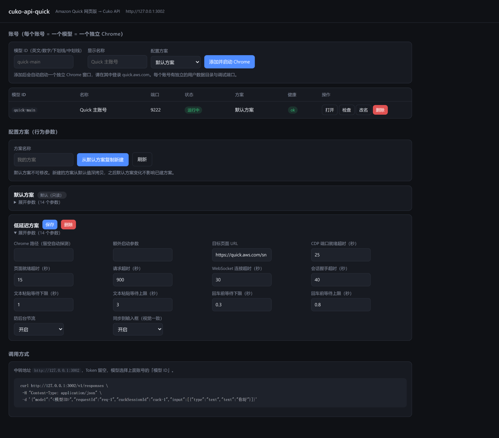
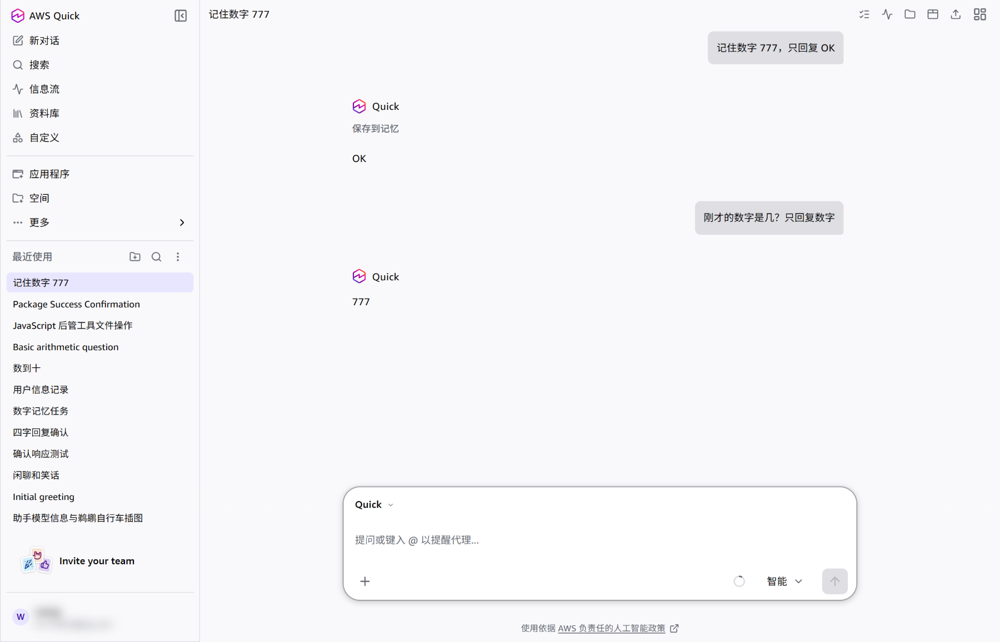
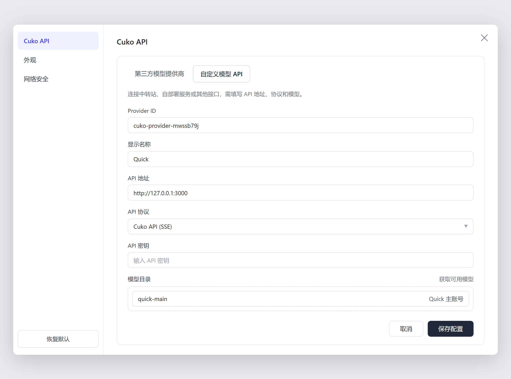
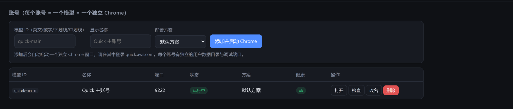
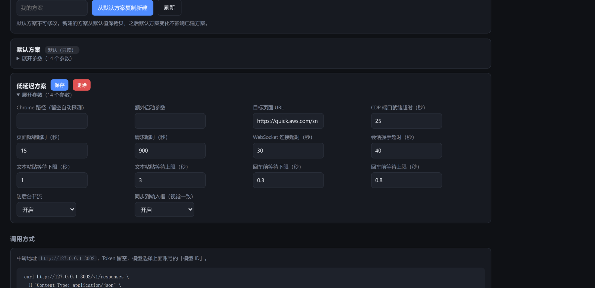

# cuko-api-quick

把 **Amazon Quick 网页版**（[quick.aws.com](https://quick.aws.com)）的聊天能力，通过 CDP 驱动独立 Chrome，
暴露成符合 **Cuko API** 契约的 HTTP/SSE 服务。

> 姊妹项目：[one-chrome-ex](https://github.com/wangtunan90)（DeepSeek 版）、`cuko-api-gpt`（ChatGPT 版）。
> 三者架构一致，差异在"怎么把网页版聊天的响应捞出来"。

---

## 界面预览

管理台（默认端口 3000，改端口后用实际地址）：



Quick 网页版里跑通的对话（第一轮回答、第二轮续接都正常，上下文保持）：



在 Cuckoo 客户端里这样配（**API 地址**填你的服务地址，**API 协议**选 `Cuko API (SSE)`，**API 密钥留空**）：



---

## 目录

- [界面预览](#界面预览)
- [它解决什么问题](#它解决什么问题)
- [快速开始](#快速开始)
- [在客户端里配置](#在客户端里配置)
- [OpenAI 兼容入口（Codex / dsh）](#openai-兼容入口codex--dsh)
- [调用示例](#调用示例)
- [配置方案](#配置方案)
- [端点](#端点)
- [它是怎么工作的](#它是怎么工作的)
- [文件与超长文本](#文件与超长文本)
- [心跳与超时](#心跳与超时)
- [踩过的坑](#踩过的坑)
- [目录结构](#目录结构)
- [打包成 exe](#打包成-exe)
- [验证](#验证)
- [常见问题](#常见问题)
- [数据与备份](#数据与备份)
- [已知限制](#已知限制)
- [免责声明](#免责声明)

---

## 它解决什么问题

Cuko API 是给 **Stateful Provider** 设计的协议：客户端只发当前这一句提示词，
上下文由 Provider 自己维护（详见 [docs/cuko-api-v1.md](docs/cuko-api-v1.md)）。
而 Quick 网页版是个需要登录、需要点按、用 WebSocket 推流的前端应用，两者对不上。

本项目就是中间那层桥：

```
Cuko 客户端 ──HTTP/SSE──▶ bridge ──CDP──▶ 独立 Chrome ──▶ quick.aws.com
```

它做的事：

- 替你点开页面、填好输入框、点发送
- 在旁边监听聊天 WebSocket，把流式内容翻译成 Cuko 的 SSE 事件
- 把 Quick 的 `thread_id` 当作 `providerSessionId` 回给客户端，实现多轮续接
- 支持多账号（每个账号独立 Chrome profile + 独立调试端口，登录态互不干扰）
- **常驻温页面 + 资源回收**：Chrome 和 Quick 页签保持打开，请求直接复用页面；页签被关掉会自动补开并去重。闲置 Chrome 会按阈值回收、常驻数量有 LRU 上限，避免内存一直涨（见[配置方案](#配置方案)里的运行时配置）
- **账号池**：多个账号可以共用一个对外「模型别名」，同账号串行排队、不同账号并行；`previous_response_id` 会粘在同一账号

---

## 快速开始

### 环境要求

| 项 | 要求 |
|---|---|
| 操作系统 | **Windows**（Chrome 启动逻辑按 Windows 写，其它平台未验证） |
| Node.js | >= 18（仅源码运行需要；exe 版不需要） |
| 浏览器 | 本机已安装 **Chrome**（自动探测 `Program Files\Google\Chrome\Application\chrome.exe`） |
| 账号 | 一个能正常登录的 Amazon Quick 账号 |

### 第一步：启动服务

**方式 A：源码运行**

- 最省事：双击项目根目录的 **`start-gateway.bat`**。会自动检查 Node、缺依赖时执行 `npm install`、后台启动服务并等接口就绪；服务已在跑时不会重复启动，只打开管理台。
- 或者手动：

```bash
npm install
npm start
```

**方式 B：单文件 exe**

下载或自行构建 `cuko-api-quick.exe`（见[打包成 exe](#打包成-exe)），双击运行即可，不需要装 Node。

启动后**会自动用默认浏览器打开管理后台**。看到这样的输出就说明起来了：

```
[bridge] 日志落盘: ...\data\logs\bridge-2026-11-23.log
[Cuko Provider] 运行在 http://127.0.0.1:3000
[Cuko Provider] 管理台: http://127.0.0.1:3000/
```

> 默认端口 3000。想换端口见[关于端口](#关于端口怎么改成别的端口)：改 `data/config.json` 重启，或临时用环境变量 `CUKO_HTTP_PORT`。

---

### 第二步：添加账号

浏览器打开 **<http://127.0.0.1:3000/>**，会看到管理台：



在「账号」卡片里填两个字段：

| 字段 | 说明 | 示例 |
|---|---|---|
| **模型别名**（必填） | 客户端看到的模型名；**别名相同的账号自动组成一个账号池**。只能用英文、数字、点、下划线、冒号、中划线，不超过 80 字符 | `quick` |
| **配置方案** | 先用「默认方案」，后面有需要再换 | `默认方案` |

内部账号 ID 由服务在锁内自动生成（`acct-1`、`acct-2`…，同时排除已有 ID 与 profile 目录），列表里悬停成员行即可查看；ID 创建后不能改名，要换只能删号重建；对外名字用「模型别名」，可以随时在账号行点「别名」修改。

例如三个账号都填别名 `quick`，客户端只看到一个模型 `quick`，请求会自动落到最空闲的账号；同账号的第二个请求会排队，而不是立刻 429。

点 **「添加并启动 Chrome」**。

这时会**弹出一个新的 Chrome 窗口**。注意几点：

- 这个窗口用的是**独立的用户数据目录**（`data/profiles/<模型ID>/`），和你平时用的 Chrome 完全隔离，不会互相影响。
- 每个账号用**独立的调试端口**，从 9222 起找第一个 TCP 可绑定的空闲端口；被占用就自动往后跳。
- 所以你可以同时加多个账号，各自登录不同的 Quick 账号，登录态互不干扰。

---

### 第三步：在弹出的 Chrome 里登录

弹出的 Chrome 会打开 `https://quick.aws.com/sn/start`，这个地址会**自动路由**到
你账号的聊天页 `/sn/account/<账号ID>/start/chat`（约 10 秒）。

> **注意不要用 `https://quick.aws.com/sn`** —— 那是产品落地页（Features / Pricing / Sign in），
> 没有聊天输入框，服务会一直等不到页面就绪。

1. 如果需要登录，点 **Sign in** 完成登录
2. 登录后确认能看到聊天输入框（占位文字「提问或键入 @ 以提醒代理...」）
3. **页面加载比较慢**，第一次进聊天页可能要十几秒，等输入框真的出来再进下一步

#### 关于账号 ID

聊天页 URL 里的 `123456789012` 这类数字是 **AWS 账号 ID**，由 Quick 登录后自动带上。
服务不会写死它，也不需要你手动填写 —— 需要时会从页面里自动探测：

| 来源 | 说明 |
|---|---|
| 当前 URL | 已在聊天页时直接取路径里的账号 ID |
| cookie `qs-directory-alias` | 最直接，形如 `123456789012` |
| localStorage `quickwork-web-last-user` | ARN 里含账号 ID，作兜底 |

如果三条都探测不到（比如还没登录过），服务会退回 `/sn/start`，让页面自己路由。

> 这个 Chrome 窗口**可以关掉**。登录态存在 `data/profiles/<模型ID>/` 目录里，下次启动还在。

### 第四步：检查账号是否就绪

回到管理台，在账号行点 **「检查」**：

- **健康列显示 `ok`** → 一切正常，可以用
- **显示 `login_required`** → 那个 Chrome 窗口还没登录，回去登录
- **显示 `error`** → 页面没加载完或者没在聊天页，点「打开」重新进一下

账号行的其他按钮：

| 按钮 | 作用 |
|---|---|
| **别名** | 修改对外模型名；改成相同值会把多个账号自动组成池 |
| **打开** | 重新拉起这个账号的 Chrome |
| **检查** | 探测登录态和输入框是否可用 |
| **删除** | 关闭这个账号的 Chrome、确认端口释放、删除用户数据目录和健康记录，**登录态不可恢复** |

管理台顶部有 **「停止服务」** 按钮：停止 HTTP 服务、停掉后台回收轮询，并逐个关闭本服务托管的 Chrome（断 CDP 连接、关进程与页签、释放调试端口），同时中断在途请求；不会删除 `data/`、账号或登录态，重启后继续使用。回收前会校验 `--user-data-dir` 归属，不会误杀你自己日常用的 Chrome。

---

### 第五步：在客户端里用

见下一节[在客户端里配置](#在客户端里配置)。

## 在客户端里配置

以 **Cuckoo 客户端**为例，打开「设置 → Cuko API → 自定义模型 API」：


按下表填：

| 配置项 | 填什么 | 说明 |
|---|---|---|
| **Provider ID** | 自动生成的即可 | 不用改 |
| **显示名称** | 随便填，如 `Quick` | 客户端里显示的名字 |
| **API 地址** | `http://127.0.0.1:3000` | **必须和服务的实际端口一致**（见下方说明） |
| **API 协议** | `Cuko API (SSE)` | 下拉里选这一项 |
| **API 密钥** | **留空** | 本项目不校验鉴权 |
| **模型目录** | 点「获取可用模型」，选你的账号 | 显示的是模型别名，如 `quick` |

### 关于端口：怎么改成别的端口

服务**默认监听 3000**。如果 3000 被占用（比如同时跑着别的 Provider），或者你想换端口，有三种方式：

#### 方式 1：改配置文件（推荐，exe 用户唯一方便的方式）

服务第一次启动时会自动生成 **`data/config.json`**：

```json
{
  "_说明": ["改完这个文件后重启程序才生效。"],
  "port": 3000,
  "host": "127.0.0.1",
  "autoOpenAdmin": true
}
```

把 `port` 改成你要的值，**保存后重启程序**即可：

```json
{ "port": 3002, "host": "127.0.0.1" }
```

> `_说明` 字段只是给人看的注释，不影响运行，可以随便改或删。

#### 方式 2：环境变量（临时改，优先级最高）

不想改文件的话，启动时用环境变量覆盖：

**Windows CMD**

```cmd
set CUKO_HTTP_PORT=3002 && npm start
```

**PowerShell**

```powershell
$env:CUKO_HTTP_PORT="3002"; npm start
```

**exe 用户**同样的写法：

```cmd
set CUKO_HTTP_PORT=3002 && cuko-api-quick.exe
```

环境变量**优先级高于配置文件**，适合临时改一次。

#### 方式 3：命令行参数

目前没做命令行参数解析，用上面两种就够了。

#### 优先级

```
内置默认 3000  <  data/config.json  <  环境变量 CUKO_HTTP_PORT
```

#### 怎么确认现在跑在哪个端口

启动日志会直接打出来：

```
[Cuko Provider] 运行在 http://127.0.0.1:3002（端口来源：data/config.json）
[Cuko Provider] 管理台: http://127.0.0.1:3002/
[Cuko Provider] 配置文件: ...\data\config.json
```

或者打开管理台，**页面顶部**和底部「调用方式」卡片都会显示当前实际地址，
curl 示例也会自动用正确的端口：

```
http://127.0.0.1:3002（端口来源：data/config.json）
```

#### 端口被占用怎么办

程序会直接告诉你怎么办，不会甩一堆报错栈：

```
[Cuko Provider] 端口 3000 已被占用。可以：
  1) 关掉占用该端口的程序（Windows 下用 netstat -ano | findstr :3000 查 PID）
  2) 换个端口：编辑 ...\data\config.json，把 port 改成别的值，然后重启
  3) 或临时用环境变量：set CUKO_HTTP_PORT=3002 && npm start
```

#### 改了端口之后，客户端也要改

别忘了 **Cuckoo 客户端里的「API 地址」要填成一样的端口**：

服务跑在 `3002` → 客户端 API 地址填 `http://127.0.0.1:3002`。

#### 不想每次启动都弹浏览器

把 `data/config.json` 里的 `autoOpenAdmin` 改成 `false`，重启生效：

```json
{ "autoOpenAdmin": false }
```

适合这几种情况：把服务跑在服务器上、用启动脚本批量拉起、或者只是不喜欢自动弹窗。

> 默认是 `true`。改完之后启动日志会提示「autoOpenAdmin 已关闭，请手动打开上面的地址」。

#### 配置文件写坏了会怎样

不会起不来。解析失败会告警并忽略该文件，回退到默认值：

```
[config] data/config.json 解析失败，忽略该文件: ...
```

`port` 填了非法值（比如字符串、0、超过 65535）同样会被忽略并告警。

### 模型目录怎么来

「获取可用模型」调的是 `GET /v1/models`，按**模型别名**聚合：

```json
{ "data": [{ "id": "quick", "name": "quick" }] }
```

- `id` = 管理台里的「模型别名」，**这个才是发请求时用的** `model` 字段
- 同别名的多个账号只返回一条，客户端不需要知道内部账号 ID
- 没填别名时，回退成内部账号 ID（例如 `aws`）

---

## OpenAI 兼容入口（Codex / dsh）

除了 Cuko 协议，服务还提供一套标准 OpenAI 兼容入口，给 Codex、dsh 等客户端用：

```text
GET  /openai/v1/models
POST /openai/v1/responses          Codex
POST /openai/v1/chat/completions   dsh / 普通 OpenAI 客户端
```

它和 Cuko 的 `/v1` 完全分开，老客户端不受影响。两个入口的模型列表都按「模型别名」聚合；同别名的多个账号会组成池。详细配置、工具调用协议和限制见 [docs/openai-compat.md](docs/openai-compat.md)。

Codex 最小配置：

```toml
model = "aws"
model_provider = "cuko"

[model_providers.cuko]
name = "Cuko Gateway"
base_url = "http://127.0.0.1:3000/openai/v1"
env_key = "CUKO_API_KEY"
wire_api = "responses"
```

dsh 最小配置：

```yaml
agent-default-model:
  provider: openai-compatible
  model: aws

llm-pi-ai:
  providers:
    openai-compatible:
      apiKeyEnv: CUKO_API_KEY
      api: openai-responses
      baseURL: http://127.0.0.1:3000/openai/v1
      models:
        - id: aws
          name: Quick AWS
          contextWindow: 128000
          maxTokens: 8192
```

> 工具调用是网关模拟的：Quick 网页版没有原生 `tool_calls`，网关会把客户端 `tools` 写进提示词，再把 `<tool_call>` 翻译成 `function_call` / `custom_tool_call` / `tool_calls`。图片附件支持最后一条 user 的 `image_url` / `input_image` data URL；其他二进制附件暂不支持。
>
> 流式正文是增量的：Quick 的 `text_delta` 到达时即逐段下发正文（Responses 先开正文 item 再写 `output_text.delta`，Chat 逐段写 content chunk）；工具调用相关事件、usage 和收尾状态仍在整轮结束后补发。详细事件顺序见 [docs/openai-compat.md](docs/openai-compat.md)。

---

## 调用示例

### 列模型

```bash
curl http://127.0.0.1:3000/v1/models
```

```json
{ "data": [{ "id": "quick-main", "name": "quick-main" }] }
```

### 新建对话（流式）

```bash
curl -N http://127.0.0.1:3000/v1/responses \
  -H "Content-Type: application/json" \
  -d '{
    "model": "quick-main",
    "requestId": "req-1",
    "cuckSessionId": "cuck-1",
    "input": [{ "type": "text", "text": "你好" }]
  }'
```

返回：

```
event: message
data: {"output":[],"providerSessionId":"ce03a5ae-b855-4cd4-9d89-48f20cefe0c0"}

event: message
data: {"output":["你好"]}

event: message
data: {"output":["！有什么"]}

event: done
data: {"finishReason":"stop","usage":{"input_tokens":4,"output_tokens":11,"total_tokens":69929}}
```

### 续接对话（第二轮）

把上一轮拿到的 `providerSessionId` 带上：

```bash
curl -N http://127.0.0.1:3000/v1/responses \
  -H "Content-Type: application/json" \
  -d '{
    "model": "quick-main",
    "requestId": "req-2",
    "cuckSessionId": "cuck-1",
    "providerSessionId": "ce03a5ae-b855-4cd4-9d89-48f20cefe0c0",
    "input": [{ "type": "text", "text": "我刚才问了什么？" }]
  }'
```

### 历史压缩（切换模型时）

```bash
curl -N http://127.0.0.1:3000/v1/responses \
  -H "Content-Type: application/json" \
  -d '{
    "model": "quick-main",
    "requestId": "req-3",
    "cuckSessionId": "cuck-1",
    "type": "compress",
    "input": [
      { "type": "text", "text": "# 角色\n你是一个助手。" },
      { "type": "text", "text": "用户:\n我叫小明，喜欢蓝色。" },
      { "type": "text", "text": "助手:\n好的，记住了。" }
    ]
  }'
```

---

## 配置方案

行为参数分两层：方案级参数在管理台「配置方案」卡片里管理，运行时级参数写在 `data/config.json`：



### 规则

- **默认方案**：硬编码在 `bridge/default-config.js`，**只读**，既不能改也不能删。
- **自定义方案**：点「从默认方案复制新建」，从当前默认值**深拷贝**一份。之后默认方案再怎么变，都不会影响已经建好的方案。
- **账号绑定**：每个账号可以指定一个方案。没指定、或指定的方案被删了，自动回退默认方案。
- **时间单位统一是「秒」**，支持小数（`0.5` 就是半秒）。
- **配置分两层**：
  - **方案级**：在管理台「配置方案」卡片里管理，随账号绑定；存在 `data/config-profiles.json`。下面的「Chrome 相关 / 超时相关 / 发送时序 / 开关」属于这一层。
  - **运行时级**：写在 `data/config.json`，改完重启生效；下面的「队列 / 预热 / 资源回收」属于这一层。
- **等待是自适应的**：页面操作等待以「条件命中即退出」为准，轮询渐进退避；上限只作兜底，不再默认在区间内随机长等。

### 字段说明

**运行时配置（`data/config.json`，改完重启生效）**

| 字段 | 默认 | 取值范围 | 说明 |
|---|---|---|---|
| `warmupOnStart` | `true` | 布尔 | 启动后后台预热账号，提前拉起 Chrome、打开 Quick 页签并建立 CDP 连接 |
| `warmupLimit` | `2` | 0–50 | 最多预热几个账号，控制内存；其余账号第一次请求时再拉起 |
| `maxQueuePerAccount` | `8` | 0–100 | 每个账号最多允许多少个请求排队（Quick 同一账号同时只能跑一轮） |
| `queueMaxWaitSec` | `60` | 1–600 | 排队最长等待秒数；超时返回 429 |
| `idleChromeSec` | `600` | 0–3600，`0` 关闭回收 | 账号闲置超过该阈值且当前无在途回合，回收其受管 Chrome；profile 目录与登录态保留，下次按需冷启动或走预热。机器内存紧张可调小，刚用完还要复用就别调太小 |
| `maxResidentChrome` | `4` | 0–50，`0` 不限 | 同时常驻 Chrome 数量上限；超出时按最久未用（LRU）回收非活跃账号。账号多、内存吃紧时调小；机器内存宽裕可放宽 |
| `sweepIntervalSec` | `60` | 0–600，`0` 关闭后台轮询 | 后台回收轮询间隔；每轮做页签去重、闲置回收、上限淘汰。想降低后台轮询频率可调大；`0` 则只在请求/删除时触发整理 |
| `detachedGraceSec` | `15` | 0–120，`0` 立即释放 | 回合进行中客户端断开后，槽位过渡期秒数；正常收尾后的 close 不进入过渡期。回合提前结束即释放，到点仍未结束由调度器强制释放。旧回合容易拖很久、又想尽快给下一轮腾槽位可调小；担心误杀收尾可调大 |

**Chrome 相关（方案级）**

| 字段 | 默认 | 说明 |
|---|---|---|
| `chromePath` | 空 | Chrome 可执行文件路径。留空则自动探测 `Program Files` 和 `Program Files (x86)` 下的标准路径 |
| `extraArgs` | 空 | 额外启动参数。例如挂代理：`--proxy-server=http://127.0.0.1:7890` |
| `targetUrl` | `https://quick.aws.com/sn/start` | 打开账号时进入的页面 |

**超时相关（方案级）**

| 字段 | 默认 | 说明 |
|---|---|---|
| `connectPollMaxSec` | 25 | 等 Chrome 调试端口就绪的最长秒数。机器慢可以调大 |
| `pageReadyPollMaxSec` | 25 | 等聊天输入框出现的最长秒数。Quick 首屏比较慢，不建议低于 20 |
| `requestTimeoutSec` | 900 | 单次请求的硬超时。真正的「卡死」由 180 秒空闲超时负责，这里只兜「永远不结束」的极端情况 |
| `wsConnectTimeoutSec` | 30 | 连接聊天 WebSocket 的最长秒数 |
| `wsAckTimeoutSec` | 40 | WebSocket 握手后等 `session_established` 的最长秒数 |

**发送时序（方案级，自适应等待；条件命中即退出，上限只作兜底）**

| 字段 | 默认 | 取值范围 | 说明 |
|---|---|---|---|
| `pollFastSec` | 0.08 | ≥0，≤ `pollSlowSec` | 轮询首次间隔（秒），先快速探一次页面状态。觉得页面响应慢、轮询太密可适当调大 |
| `pollSlowSec` | 0.22 | ≥ `pollFastSec` | 连续未就绪后退避到的轮询间隔（秒），降低 CDP 压力。CDP 压力大、CPU 占用高可调大 |
| `pollRampAfterAttempts` | 2 | ≥1 整数 | 前 N 次尝试用快速间隔，之后退避到慢间隔 |
| `pasteVerifyMaxSec` | 0.6 | ≥0 | 填词后核对「输入框内容与预期一致」的基准窗口（秒），匹配上立即退出；长文本窗口按长度放大，封顶见 `pasteVerifyCapSec` |
| `pasteVerifyCapSec` | 2.0 | ≥ `pasteVerifyMaxSec` | 填词核对窗口的绝对上限（秒），长提示词按长度放大后在此封顶，避免渲染慢被误判 |
| `preEnterMinSec` | 0.05 | ≥0 | 回车前保底等待（秒），只给 React 一次状态更新机会。若出现发送未确认，再适当调大 |
| `composerRetryDelaySec` | 0.4 | ≥0 | 填词失败、重试一次之前的等待（秒） |
| `attachSyncDelaySec` | 0.3 | ≥0 | 附件挂载完成后同步到发送逻辑的短等待（秒） |

> 旧字段 `textPasteWaitMinSec` / `textPasteWaitMaxSec`（1.0 / 3.0）、`preEnterWaitMinSec` / `preEnterWaitMaxSec`（0.8 / 2.5）仅为兼容老配置保留，发送编排不再消费；老配置文件仍能通过校验，缺新字段时自动补默认值。

**开关（方案级）**

| 字段 | 默认 | 说明 |
|---|---|---|
| `disableBackgroundThrottling` | 开 | 给 Chrome 加防后台节流参数。**必须开**，否则 Chrome 在后台时会被节流，点不动发送按钮 |
| `uiPasteToInput` | 开 | 是否把内容同步到输入框（让页面视觉上和真人操作一致） |

### 调参建议

- **觉得慢**：常态等待已是条件命中即退出（默认合计约 0.2 秒量级）；先确认不是页面本身慢。仍想压轮询开销可微调 `pollFastSec` / `pollSlowSec`，不要把 `preEnterMinSec` 压到 0 以下。
- **经常「输入区未就绪」**：把 `pageReadyPollMaxSec` 调到 `40`，`connectPollMaxSec` 调到 `40`；填词核对不上再适当调大 `pasteVerifyMaxSec`。
- **出现发送未确认**：把 `preEnterMinSec` 适当调大（如 `0.15`），给 React 多一次状态更新机会。
- **长任务被中断**：把 `requestTimeoutSec` 调大（如 `1800`）。
- **电脑内存吃紧 / Chrome 越开越多**：调小 `maxResidentChrome`、`idleChromeSec`；`sweepIntervalSec` 保持默认即可。

---

## 端点

### Cuko API

| 方法 | 路径 | 说明 |
|---|---|---|
| GET | `/v1/models` | 模型别名列表（同别名账号已聚合） |
| POST | `/v1/responses` | 发送消息（SSE 流式） |

### OpenAI 兼容 API

| 方法 | 路径 | 说明 |
|---|---|---|
| GET | `/openai/v1/models` | OpenAI 格式模型列表 |
| GET | `/openai/v1/models/:id` | 单个模型 |
| POST | `/openai/v1/responses` | OpenAI Responses（Codex） |
| POST | `/openai/v1/chat/completions` | OpenAI Chat Completions（dsh / 普通客户端） |

### 管理 API

| 方法 | 路径 | 说明 |
|---|---|---|
| GET | `/` | 管理台页面 |
| GET | `/api/info` | 当前监听地址、端口来源、配置文件路径 |
| POST | `/api/shutdown` | 停止服务、停后台回收轮询并关闭受管 Chrome、释放调试端口（不删账号/登录态） |
| GET | `/api/accounts` | 账号列表（含别名、池大小、运行/排队状态、在线、健康、生效方案） |
| POST | `/api/accounts` | 新增账号（`modelAlias` 必填、`profileId` 可选；`modelId` 省略时后端自动生成唯一内部 ID，自动启动 Chrome） |
| PUT | `/api/accounts/:id` | 修改模型别名或绑定配置方案 |
| DELETE | `/api/accounts/:id` | 关闭该账号的 Chrome、释放端口、删除数据目录和健康记录（不可恢复） |
| POST | `/api/accounts/:id/open` | 打开 Chrome |
| GET | `/api/accounts/:id/health` | 账号健康检查 |
| GET | `/api/profiles` | 配置方案列表 |
| POST | `/api/profiles` | 新建方案 |
| PUT | `/api/profiles/:id` | 修改方案 |
| DELETE | `/api/profiles/:id` | 删除方案 |

**`POST /api/accounts` 请求体**：
- `modelAlias`（必填）：对外模型名；同别名账号自动组成一个池、可并行。字符集英文/数字/`.`/`_`/`:`/`-`，不超过 80 字符。
- `modelId`（可选）：内部唯一身份；省略时后端自动生成 `acct-1`、`acct-2`…（同时排除 accounts.json 已有 ID 与已存在的 profile 目录），显式传入则原样保留。
- `profileId`（可选）：绑定配置方案，缺省 `default`。

---

## 它是怎么工作的

### 发送：驱动页面，而不是模拟协议

Quick 网页版的输入框是 **React 受控的原生 textarea**。直接改 `value` 不会触发状态更新，
发送按钮会一直是 `disabled`。所以：

```js
// 用原生 setter + 派发 input 事件，React 才会感知
const setter = Object.getOwnPropertyDescriptor(window.HTMLTextAreaElement.prototype, 'value').set;
setter.call(el, text);
el.dispatchEvent(new Event('input', { bubbles: true }));
```

然后等 `button[aria-label="发送消息"]` 从 disabled 变可用，点它（回车作兜底），
再用「输入框清空 / 出现停止按钮」确认真的发出去了。

### 接收：监听页面的 WebSocket

Quick 网页端聊天走 WebSocket（**不是 HTTP SSE**）：

```
wss://<ws_host>/streaming/quickwork-chat-bidirectional-stream
  ?surfaceType=...&token=<id_token>&workingSessionId=...&channel=prod
```

我们不让 Node 自己连这条连接 —— URL 里的 `token` 是约 1 小时轮换的 id_token，
`ws_host` 按租户不同，还有`outpostId`/`workingSessionId` 等握手字段。
页面本来就维护着一条可用连接，凭据刷新、重连都由它负责。

所以改为：**经 CDP 的 `Network` 域旁听**，用 `Network.webSocketFrameReceived` 拿下行帧。

### 解码：AWS event-stream + CBOR

下行帧不是裸 JSON，而是两层包装：

```
AWS event-stream 帧
├── 12B prelude（totalLen / headersLen / preludeCRC）
├── headers（:event-type=rawOutputEvent, :content-type=application/cbor）
├── payload  ← 这里是一个 CBOR map
└── 4B messageCRC

CBOR map: { "payload": <bytes> }   ← bytes 里才是 inner JSON
inner JSON: {"type":"text_delta","payload":{"delta":"你好"},"thread_id":"..."}
```

`bridge/quick-protocol.js` 里手写了这套编解码（含 CBOR 子集解码器），
并把事件流归并成 Cuko 需要的 `{text, think, usage, finished, error, threadId}`。

一轮对话的结束判据：`message_complete` 且 `payload.continuation_expected !== true`。
agentic 多步任务会连续发多轮 `message_start … message_complete`，前几轮带 `continuation_expected: true`。

### 会话续接

Quick 的 `thread_id`（也就是 URL 里的 `conversationId`）就是会话句柄。
第一轮从下行事件里拿到，作为 `providerSessionId` 回给客户端。

**续接时服务会真的切到那个会话**：

1. 从当前 URL 解析出 AWS 账号 ID
2. 导航到 `/sn/account/<账号ID>/start/chat?conversationId=<sessionId>`
3. 轮询等 URL 里的 `conversationId` 变成目标值
4. 再等聊天输入区渲染完成（Quick 是 SPA，切会话后要重新渲染约 2~4 秒）
5. 然后才填入并发送

如果会话切不过去，会明确报错而不是闷头往错的会话里发消息。

> **注意**：会话 ID 是绑定在 Quick 账号上的。如果你换了 Quick 账号登录
> （同一个 Chrome profile 里重新登录了别的账号），旧的 `providerSessionId`
> 就失效了，需要让客户端**新建对话**。

网关会在 `data/openai-sessions.json` 里保存这层映射，默认 24 小时滑动过期：
网关重启后 24 小时内仍能回到同一个 Quick 线程；超过 TTL 后才需要新建对话。
`CUKO_OPENAI_SESSION_TTL_MS` 可改过期时间，`CUKO_OPENAI_SESSION_FILE` 可改落盘路径
（设为空串表示只保留内存映射）。

## 文件与超长文本

### 超长文本自动转附件

Cuko 客户端会把**工具调用结果**当普通文本项发过来，动辄几万字符。
直接塞进 Quick 的输入框既慢、又容易被页面截断，所以服务会自动处理：

| 单个文本项长度 | 处理方式 |
|---|---|
| ≤ 20000 字符 | 正常走输入框 |
| > 20000 字符 | 写成 `.txt` 附件发送，正文只留说明 + 开头 400 字 + 结尾 200 字 |

模型能完整读到附件内容（已用暗号实测验证：文件里写一串独有字符，模型能准确答出）。

摘要长这样：

```
【附件 tool-result_xxx.txt】内容过长（26225 字符），已作为附件发送，请读取附件内容。
以下是开头片段：
【工具调用结果】web_search 返回 250 条记录
校验暗号：蓝宝石-9527
……（中间省略 25625 字符）……
结尾片段：
记录 600: https://example.com/item/599 摘要内容占位
```

### Cuko 的 file 项

协议里的文件输入也支持（`docs/cuko-api-v1.md` §3.2）：

```json
{ "type": "file", "filename": "a.pdf", "mimeType": "application/pdf", "data": "base64..." }
```

服务会把 base64 解码落盘，再走同一条附件通道。也兼容带 `data:...;base64,` 前缀的写法。

只有文件、没有文本时，会自动补一句「【附件】共 N 个文件：…，请查看附件内容」，
避免发出一条空消息。

### 实现原理

不需要调 Quick 的任何 REST 接口，而是复用页面自己的能力：

1. 页面里本来就有个隐藏的 `input[type=file]`（`accept=*`、`multiple`）
2. 用 CDP 的 `DOM.setFileInputFiles` 把本地绝对路径塞进去
3. 页面自己走完 `presigned-url` → DLP 扫描 → `files/upload`
4. 等附件卡片出现 → 填正文 → 点发送

临时文件落在 `data/tmp-attachments/`，发送完成后自动清理。

## 心跳与超时

### SSE 心跳（保活）

请求处理期间，每 `keepAliveSec`（默认 20 秒）发一个 SSE 注释帧：

```
: keepalive 20s
```

注释帧以 `:` 开头，SSE 客户端会自动忽略它，**不会被当成正文**。
作用是让连接在长时间无数据时不被中间代理或客户端掐断。
后面的数字是「已用时长」，方便排查卡在哪。

Cuko `/v1` 入口按配置方案的 `keepAliveSec`（默认 20 秒）发帧；OpenAI `/openai/v1` 入口的 keepalive 间隔为内置 15 秒，帧内容不带时长数字。

### 空闲超时（判定卡死）

`idleTimeoutSec`（默认 180 秒）表示「连续这么久**没有任何聊天事件**」。

关键点：**每收到一个事件就会重置这个计时器**，所以只要页面还在输出
（思考、正文、工具进度、心跳），就不会触发。

到点后还会做一次**二次确认**：问页面「还在生成吗」（检测停止按钮）。

| 页面状态 | 处理 |
|---|---|
| 仍在生成 | 继续等待，**不设次数上限** |
| 已停止生成 | 判定超时，返回 `request_timeout` |

这样设计是因为 Quick 的思考阶段可能长时间静默 —— 实测有一次长任务
**连续 39 秒没有任何事件**，但页面一直在正常生成。

### 请求总超时（最后兜底）

`requestTimeoutSec`（默认 900 秒）是硬上限，只用来兜「永远不结束」的极端情况。
正常情况下应该由空闲超时先触发。

### 实测

| 场景 | 结果 |
|---|---|
| 80 秒长任务，中间 39 秒静默 | ✅ 正常完成，无超时 |
| 心跳 | ✅ 20s / 40s / 60s 准时发出 |
| 页面真停止生成 | ✅ 正常判超时 |

## 踩过的坑

这些都是实测撞出来的，写下来避免重蹈覆辙。

| 坑 | 结论 |
|---|---|
| **帧 payload 是 CBOR，不是 JSON** | 一开始按桌面端的 `JSON + base64` 实现，解出来全是 0 条事件。看 header 才发现 `:content-type=application/cbor`。 |
| **`Network.webSocketCreated` 不可依赖** | 页面在 CDP 客户端连上来**之前**就建好了聊天连接，该事件不会再触发；但 `webSocketFrameReceived` 照常到达。所以不能拿它做前置 gate，得按帧内容过滤。 |
| **直接改 textarea.value 无效** | React 受控组件，必须用原生 setter + 派发 `input` 事件，否则发送按钮永远 disabled。 |
| **输入框没有任何标识** | 原生 textarea，无 id / class / data-testid / aria-label，只有 placeholder「提问或键入 @ 以提醒代理...」。选择器只能靠 placeholder 或「最后一个可见 textarea」。 |
| **回车不一定能发送** | 页面可能把 Enter 当换行。优先点 `button[aria-label="发送消息"]`，回车作兜底。 |
| **`turn_usage.total_tokens` 是整个上下文** | 实测 70000+（含约 70k 的 prompt cache），**不是本轮增量**。别拿它算本轮花费。 |
| **必须停在 `/start/chat`** | 停在 `/sn` 落地页时页面上没有输入框。页面被用户导航走了，请求会明确报错。 |
| **Chrome 进程被父进程回收** | 用 `spawn(detached:true)` 或 PowerShell `Start-Process` 启动，否则父进程一退出调试窗口就没了。 |

---

## 目录结构

```
bridge/
  index.js            HTTP 服务、Cuko 路由、管理 API
  app-paths.js        运行目录解析
  default-config.js   默认配置方案、字段校验、自适应等待决策纯函数
  store.js            账号/方案/健康检查持久化 + 日志落盘
  account-scheduler.js 模型别名 → 账号池、账号级串行槽位、有界队列与断连过渡期（纯内存，可单测）
  account-health.js   账号健康记录 → 入口错误（未登录/限额）
  runtime-config.js   端口、预热、队列、资源回收等运行时配置
  chrome-pool.js      常驻 Chrome 池：闲置回收、LRU 上限淘汰、页签去重、停服清理
  chrome.js           Chrome 启动、调试端口探测、页签自愈/去重、关闭与归属校验
  warmup.js           启动预热与就绪登记
  profile-check.js    Chrome 启动参数的 profile 归属纯函数（可单测）
  serial-lock.js      管理接口串行写锁（防止并发读改写互相覆盖）
  cdp-connection.js   每账号常驻 CDP 连接 + 事件作用域分发
  quick-protocol.js   ★ 协议层：event-stream 拆帧 + CBOR + 事件归并（纯函数，可单测）
  quick-transport.js  经 CDP 观测 / 注入聊天 WebSocket 帧
  page.js             ★ 页面选择器与求值表达式（全部基于实测 DOM）
  quick-sender.js     ★ 填词、自适应等待、点发送、判定已发出
  chat.js             单轮对话主流程
  compress.js         历史压缩请求
  health.js           账号健康检查
  input.js            输入项归一化（兼容各种 input 形态）
  attachments.js      超长文本 / 文件附件落盘与清理
  clipboard.js        Windows 剪贴板操作（备用路径）
  openai/             OpenAI Responses / Chat 入口：会话映射、增量写入器、工具调用模拟
ui/
  index.html          管理台（单文件，无构建）
docs/
  cuko-api-v1.md      Cuko API 协议契约
  quick-protocol.md   ★ Quick 网页版聊天协议实测分析
  requirements/       需求档案
test/
  run.mjs             测试运行器
  protocol.test.mjs   协议层回归测试
  fixtures/           真实抓包样本（下行 / 上行）
scripts/
  build-docs-index.mjs  需求索引生成器
data/                   运行时数据（.gitignore）
  accounts.json         账号列表
  config-profiles.json  用户配置方案
  profiles/<modelId>/   各账号的 Chrome 用户数据（登录态）
  logs/                 运行日志
```

---

## 打包成 exe

需要 Node.js >= 25.5（内置 `--build-sea`），在 Windows 上构建：

```bash
npm install
npm run build:exe
```

产物：

```
dist/
  cuko-api-quick.exe   约 100 MB，自带 Node 运行时，目标机不用装 Node
  使用说明.txt          给最终用户的说明
```

- `ui/index.html` 作为 SEA asset 内嵌进 exe；`data/` 不打进去，首次运行在 exe 同目录自动创建。
- 路径基准统一由 `bridge/app-paths.js` 计算：开发时是项目根，打包后是 exe 所在目录。
- `bufferutil` / `utf-8-validate` 是 ws 的可选加速模块，不打包，运行时会自动回退 JS 实现。
- exe 未签名，SmartScreen 提示时选择「更多信息 → 仍要运行」。

> 构建脚本会自动找一个支持 `--build-sea` 的 node（本机 `process.execPath` 若是
> 不支持该参数的版本，会去 PATH / Program Files 里找）。也可用环境变量
> `NODE_SEA_BIN` 显式指定。

### 自动发布（GitHub Actions）

仓库带了一个 workflow：`.github/workflows/release-exe.yml`。

**打 tag 就会自动构建并发布 exe**：

```bash
git tag v0.0.2
git push origin v0.0.2
```

也可以在 GitHub 网页上：

- **Actions → Release EXE → Run workflow**，填 tag 名手动触发
- 或直接**创建 Release**（Publish 时触发）

workflow 做的事：

| 步骤 | 内容 |
|---|---|
| 环境 | `windows-latest` + Node 26（`--build-sea` 需要 >= 25.5） |
| 依赖 | `npm ci` |
| 测试 | `npm test`（当前 184 项回归；以实际运行汇总为准） |
| 构建 | `npm run build:exe` |
| 校验 | 检查 exe 存在且体积 > 50 MB（防止构建静默失败） |
| 冒烟 | 真的启动 exe，请求 `/v1/models`、`/`、`/api/info` 确认可用 |
| 发布 | 上传 `cuko-api-quick-<tag>.exe` + `使用说明-<tag>.txt` 到 Release，自动生成 release notes |

产物同时作为 workflow artifact 保留 30 天。


## 验证

```bash
npm test
```

协议层与关键修复回归测试，**基于真实抓包样本（账号/邮箱等标识已脱敏，`test/fixtures/`）**，
覆盖：拆帧、CBOR 解码、分片重组（按 7 字节切片）、事件归并、上行帧编码往返、
附件落盘、配置校验、Chrome profile 归属校验、TCP 端口检查、串行写锁、CDP 作用域回收、
OpenAI 增量流式与收尾顺序、发送时序自适应决策、常驻回收 / LRU 淘汰 / 槽位过渡期。

```
  PASS  拆帧：单条下行消息结构正确
  PASS  CBOR 解码：第一条是 message_start
  ...
  PASS  profile 校验：缺少 user-data-dir 时拒绝
  PASS  端口检查：被 TCP 服务占用时返回 false，释放后返回 true
  PASS  串行锁：任务按入队顺序执行，前一个失败不阻塞后续
  PASS  QuickChannel.close 会把作用域从连接里摘掉

184 通过 / 0 失败
```

真机验证：加账号 → 用上面的 `curl -N` 打 `/v1/responses` 看流式输出。
删除账号时的行为：关闭受管 Chrome、释放调试端口、删除 profile 目录和 health 记录（登录态不可恢复）。

测试覆盖的链路：新建对话、会话续接（上下文保持）、历史压缩、
账号级串行排队、客户端中途断开清理、账号健康检查、管理台交互；
真机端到端表现（多轮、队列、页签自愈、并发与内存）以最终真机复测为准。

### 性能前后对照（测量口径与基线典型值）

> 改造后的真机首字延迟、总耗时、并发与内存数字，以最终真机复测为准；本节只记录改造前基线与测量口径。
> 测量脚本：`.agents/perf-baseline.mjs`（真实 HTTP，`127.0.0.1:3000`；ttfb=响应头，ttft=第一段有实际正文的 SSE 数据，total=流结束）。

改造前基线（2026-11-23，单账号严格串行，每入口 2 轮，prompt「用一句话说明什么是SSE。」）：

| 入口 | ttfb | ttft（首字） | total | 备注 |
|---|---|---|---|---|
| `/openai/v1/chat/completions`（stream） | 43ms | 约 10274ms | 约 10275ms | 改造前正文整轮结束才吐，首字≈总耗时 |
| `/openai/v1/responses`（stream） | 9ms | 约 9538ms | 约 9538ms | 同上 |
| `/v1/responses`（Cuko，对照组） | 13ms | 约 9070ms | 约 12623ms | 原本就是增量，不应回归 |

资源基线（同一时刻）：Node 网关主进程约 40MB；单账号一套 Chrome 约 0.5GB 峰值（基线 10 个 Chrome 进程约 373MB 合计）。
发送时序改造前每轮固定/随机等待合计约 1.8–5.5 秒（粘贴 1.0–3.0s + 回车前 0.8–2.5s）；改造后常态条件命中即退出，理论合计约 0.21 秒量级，轮询节奏模拟脚本见 `.agents/perf-send-timing.mjs`。

---

## 常见问题

**Q：Chrome 被关掉了，Cuko 客户端报「Provider 内部错误（ECONNREFUSED）」？**

不用管，**服务会自动把 Chrome 拉起来**。

实测：Chrome 完全关闭状态下发请求，服务检测到调试端口不通 →
自动启动 Chrome → 等端口就绪 → 等页面加载 → 发送消息 → 返回结果，
全程约 17 秒，客户端只会感觉「这条回复慢了点」，不会报错。

启动过程的日志：

```
[Chrome] 账号 quick-main 调试端口 9222 不通，自动启动 Chrome…
[Chrome] 账号 quick-main 已启动，端口就绪
[CDP-conn] connected: quick-main port 9222
[Chat] 页面就绪，输入区选择器=textarea…
```

只有在**真的启动不了**时才会报错（比如没装 Chrome、端口被别的程序占用），
错误信息里会写明具体原因和排查步骤。

> 前提是那个 Chrome profile 里之前登录过 Quick。如果从未登录，
> 自动拉起的窗口会停在登录页，需要你手动登录一次。

**Q：管理台的「健康」显示 `login_required`**

弹出的那个 Chrome 窗口还没登录。点账号行的「打开」，在弹出的窗口里登录 quick.aws.com。

**Q：显示 `error`，提示「未找到聊天输入区」**

通常是这几种情况：

1. 页面还停在 `https://quick.aws.com/sn` 落地页（介绍页），没进到聊天页 → 在窗口里点「新对话」
2. 页面还没加载完 → 等一会儿再点「检查」
3. Chrome 被关掉了 → 点「打开」

**Q：请求报「页面输入区未就绪」**

同上。另外确认那个 Chrome 窗口没有被你导航到别的网站。

**Q：返回 429「账号池排队已满 / 排队超时」**

同一个账号页面上只有一份输入框，同一时间只能跑一轮；服务会把后续请求放进有界队列。
要提升并发，请加多个账号并填**同一个模型别名**组成池；不同账号会并行。队列长度和最长等待时间在 `data/config.json` 的 `maxQueuePerAccount` / `queueMaxWaitSec` 调整。

**Q：启动报「端口 3000 已被占用」**

程序会把三种解决办法直接打出来。最省事的是编辑 `data/config.json` 把 `port` 改掉再重启，
详见[关于端口：怎么改成别的端口](#关于端口怎么改成别的端口)。

**Q：Chrome 起不来，日志里一堆 `--enable-logging=stderr` 的错误**

先确认 Chrome 确实装在标准路径。装在其他位置的话，在配置方案里把 `chromePath` 填成完整路径。

**Q：exe 双击后一闪而过**

多半是端口被占用或数据目录没写权限。用命令行跑能看到报错：

```cmd
cd 到 exe 所在目录
cuko-api-quick.exe
```

**Q：SmartScreen 拦截了 exe**

exe 未签名。点「更多信息」→「仍要运行」。

**Q：能不能同时跑多个 Quick 账号？**

可以。每个账号独立 Chrome profile + 独立调试端口，互不干扰。各自登录各自的 Quick 账号，客户端里选不同模型即可。

---

## 数据与备份

所有运行时数据都在 **`data/`** 目录（exe 版是 exe 同级目录）：

```
data/
  config.json            运行时配置（HTTP 端口、监听地址）
  accounts.json          账号列表（内部 ID / 模型别名 / 调试端口 / 绑定方案）
  config-profiles.json   自定义配置方案
  account-health.json    健康检查结果
  logs/                  运行日志，按天分文件
  profiles/<模型ID>/      各账号的 Chrome 用户数据（★ 登录态在这里）
```

**迁移 / 备份**：整个 `data/` 目录拷走即可，换机器接着用，登录态不会丢。

**注意**：`data/profiles/` 里包含你的 Quick 登录凭据，**不要提交到 Git、不要分享给别人**。
项目已把 `data/` 加进 `.gitignore`。

**重置某个账号**：删掉账号（会关闭它的 Chrome、释放端口、删 `data/profiles/<模型ID>/` 和健康记录），再重新添加、重新登录。

---

## 已知限制

- **Tools / MCP 的边界**：Cuko `/v1/responses` 普通轮次不透传 Tools；`/openai/v1` 提供**模拟**工具调用（把客户端 `tools` 写进提示词，再翻译 `<tool_call>`，不是 Quick 原生 `tool_calls`）。网关本身不提供 MCP 配置入口；MCP 由 Cuckoo `cuckoo-js` 模式在本地执行。Quick 自带工具由 Quick 服务端执行，结果只体现为正文。
- **单账号单并发**：同一账号同时只允许一轮对话（页面上只有一份输入区）；后续请求进入有界队列，队列满或等待超时返回 429。多个账号填同一模型别名可并行。
- **图片附件**：已实测 PNG 可上传并被模型读取；其他格式按 Quick 的 `accept=*` 行为处理，未逐一验证。
- **依赖页面结构**：选择器基于 2026-11-23 的实测 DOM，Quick 大改版可能导致失效。相关逻辑集中在 `bridge/page.js`，改动面很小。
- **仅 Windows 验证**：Chrome 启动和剪贴板部分按 Windows 写，其它平台未测试。
- **不支持手动转移会话**：`previous_response_id` 会自动粘住原账号；但账号被删/不可用后，已有会话不能手动迁到另一个账号，只能重新开始。
- **双真实账号并发尚未真机验证**：同别名多账号的并行/粘性已有调度器与入口层单测覆盖；当前环境只有一个已登录 Quick 账号 `aws`，添加第二个真实登录态后建议复测。

---

## 免责声明

本项目通过自动化驱动网页界面工作，**与 Amazon / AWS 无任何关联**，非官方实现。

请仅在你拥有或获得明确授权的账号上使用，并遵守相关服务条款。
使用自动化手段访问服务可能违反其条款，账号可能被限制或封禁，请自行评估风险。
